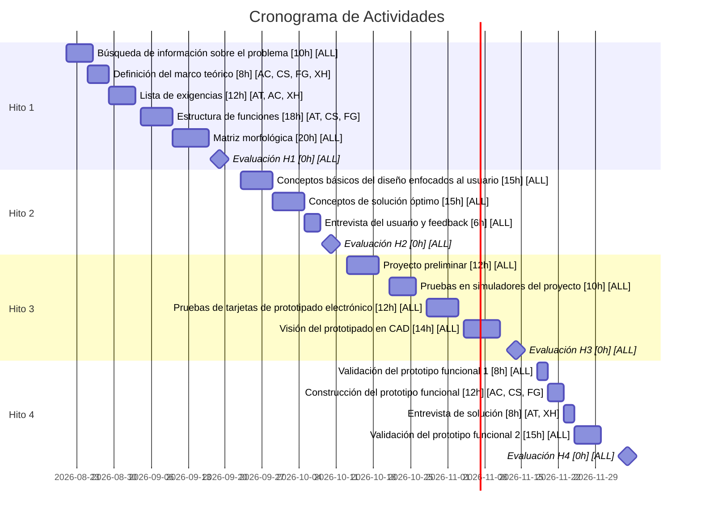

# Cronograma del Proyecto

| Abreviatura | Integrante |
| :---: | :--- |
| **AT** | Adriano Tassi |
| **AC** | Alessandro Crossby |
| **CS** | Camila Seijas |
| **FG** | Fabio García |
| **XH** | Xavier Hernandez |
| **ALL** | Todos los integrantes |

