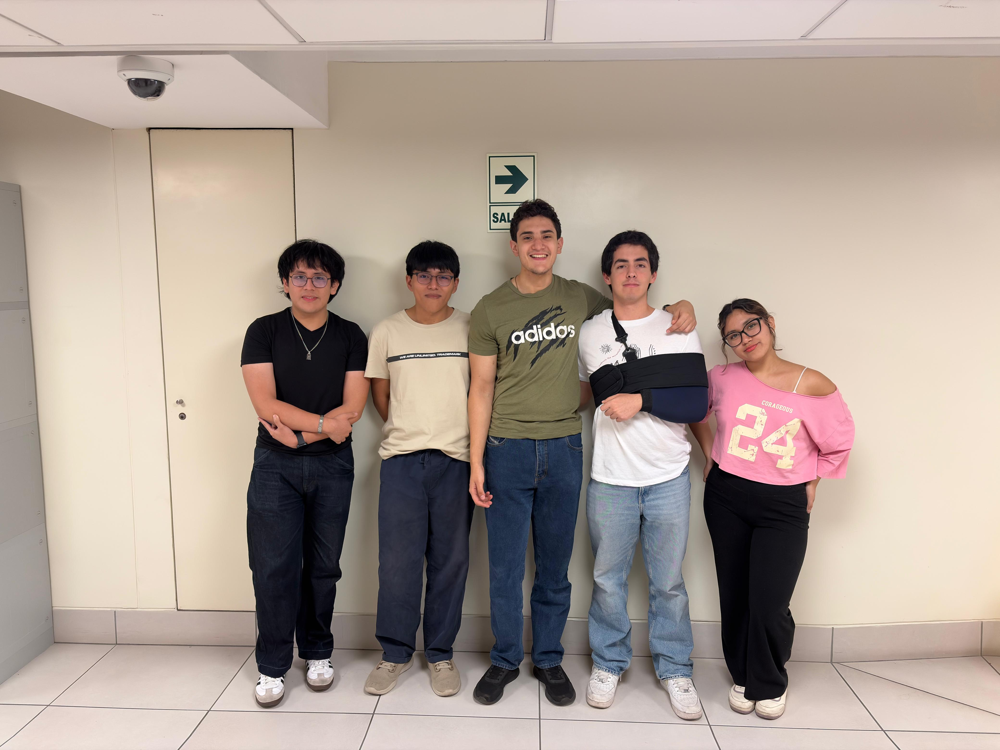

<h1>PROYECTOS DE BIODISEÑO - Grupo 1</h1>

Bienvenidos al repositorio del grupo 1 del curso "Proyectos de biodiseño 1" horario B601

Tema de interés: Retinopatía diabética

Integrantes:
- Adriano Tassi Romero - adriano.tassi@upch.pe
- Alessandro Nicolas Crosby Collantes - alessandro.crosby@upch.pe
- Camila Andrea Seijas Rojas - camila.seijas@upch.pe
- Fabio Ivan Garcia Soto - fabio.garcia@upch.pe
- Xavier Alexis Hernandez Jeronimo - xavier.hernandez@upch.pe

Problemática:
- Dificultad de acceso al diagnóstico de retinopatía diabética en zonas rurales o de bajos recursos.
- Falta de herramientas accesibles y automatizadas que permitan a médicos no especialistas realizar un diagnóstico preventivo de retinopatía diabética.

  
